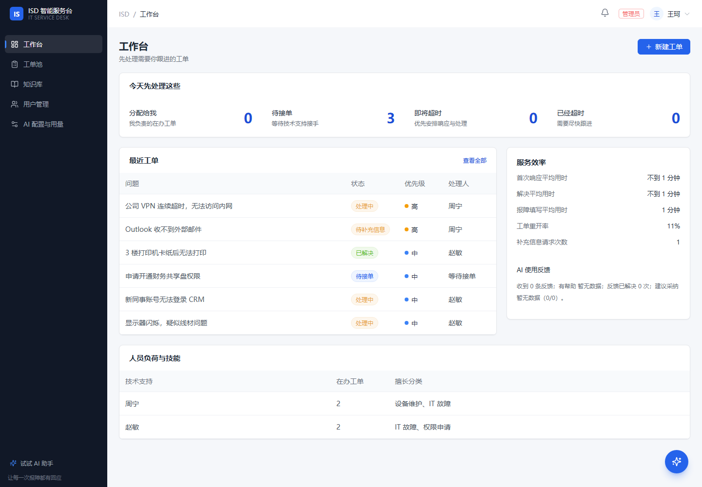
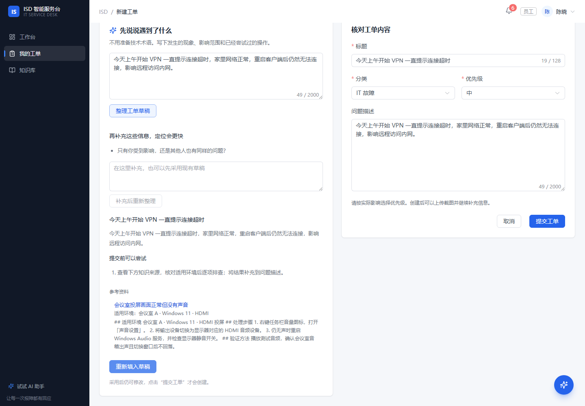
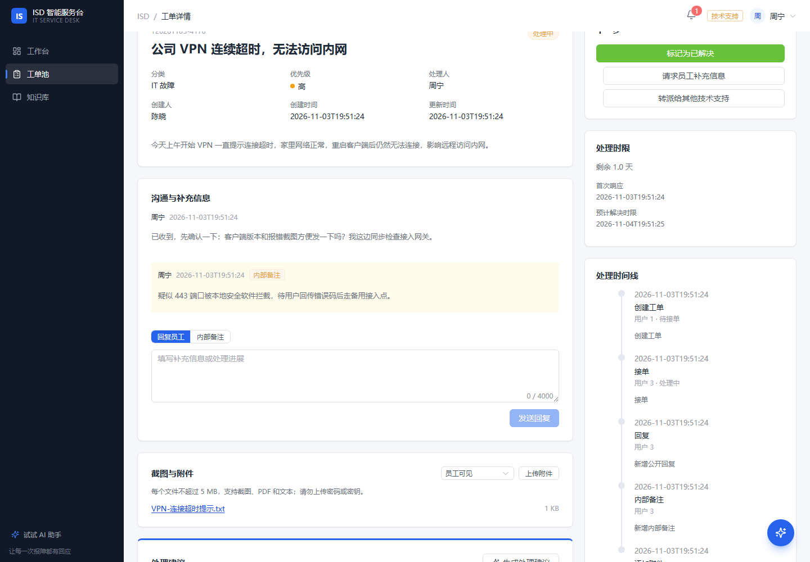
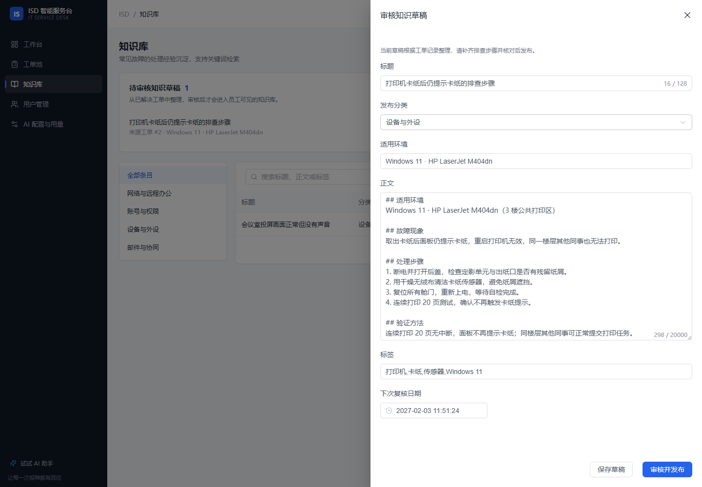
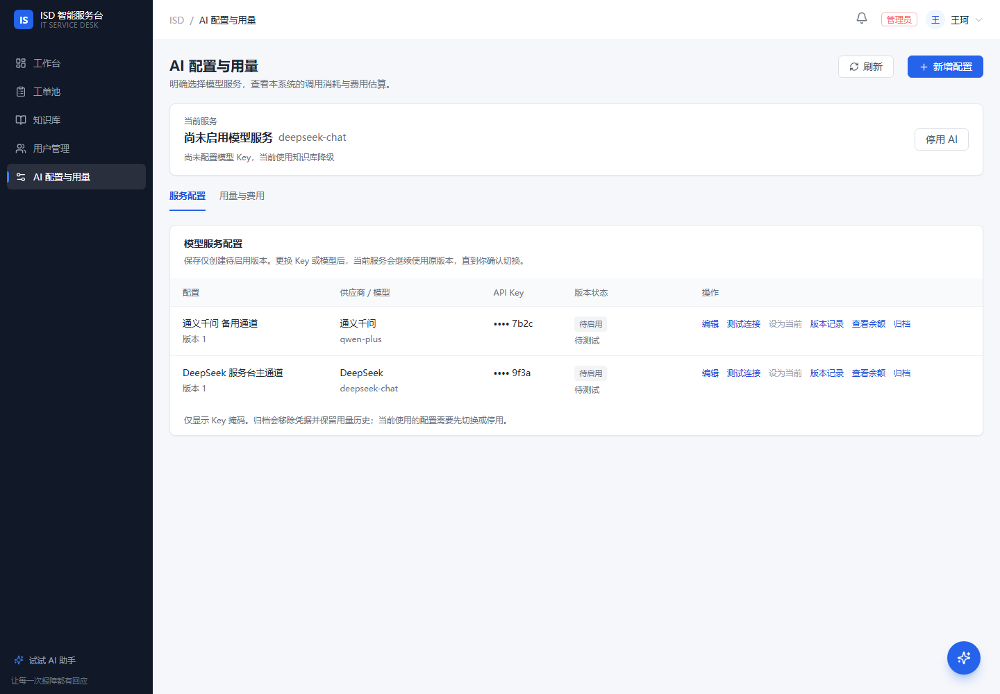
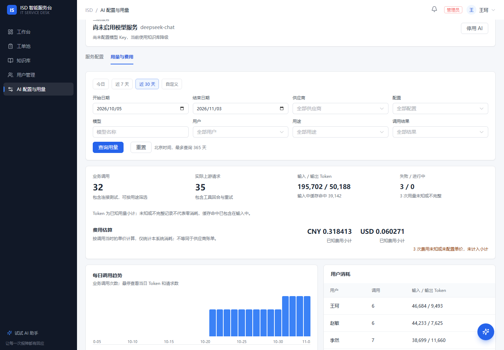

# Intelligent Service Desk

[](https://github.com/adfkj2/intelligent-service-desk/actions/workflows/ci.yml)
[](https://github.com/adfkj2/intelligent-service-desk/releases/tag/v1.1.0)
[](LICENSE)
[](docs/release-checklist.md)

**企业内网 IT 服务台**：员工用一句话报障，技术支持在工单里协作处理，解决经验沉淀为可审核的知识，AI 全程辅助但从不替人做决定。

- **对员工**：不用学工单模板，描述现象即可得到可编辑草稿，AI 会追问缺失信息。
- **对技术支持**：公开回复与内部备注分离，附件、处理时限、转派和重开都在一个时间线里。
- **对管理员**：人员负荷、AI 供应商、Key、调用量与分币种费用都能在后台看清。

[](docs/screenshots/workbench.png)

*图 1：管理员工作台（演示环境，示例数据）。*

> 截图均来自真实运行页面，使用虚构账号与示例数据；不包含真实密钥、内部地址或个人信息。AI 用量为页面明确标注的模拟台账数据。

---

## 快速入口

| 我想… | 去哪里 |
|---|---|
| **下载 v1.1.0** | [Release 附件](https://github.com/adfkj2/intelligent-service-desk/releases/tag/v1.1.0)：`isd-1.1.0.jar`、`isd-1.1.0-source.zip`、`SHA256SUMS.txt` |
| **5 分钟跑起来** | [三步启动](#三步启动) |
| **先看看页面** | [功能导览](#功能导览) |
| **部署到内网** | [部署与运维](docs/operations.md) |
| **从 v1.0.0 升级** | [升级到 v1.1.0](docs/upgrade.md)（先备份数据库与 AI 主密钥） |
| **这次改了什么** | [CHANGELOG](CHANGELOG.md) · [v1.1.0 发布说明](docs/release-notes-v1.1.0.md) |

---

## 三步启动

不需要安装 Java、Node.js、Maven、MySQL 或 Redis。

### 1. 安装 Docker Desktop

下载并完成 [Docker Desktop](https://www.docker.com/products/docker-desktop/) 首次设置，使用 Linux 容器模式。

### 2. 解压源码包，双击 `demo.cmd`

从 Release 下载 `isd-1.1.0-source.zip`，解压后双击根目录的 **`demo.cmd`**。窗口会检查 Docker、构建镜像、等待数据库和应用就绪，然后自动打开浏览器。首次需要下载依赖，通常几分钟；之后复用缓存。

### 3. 用演示账号登录

| 角色 | 账号 | 密码 |
|---|---|---|
| 管理员 | `demo_admin` | `admin12345` |
| 技术支持 | `demo_sup` | `support123` |
| 员工 | `demo_emp` | `employee123` |

打开 <http://localhost:8081/>，建议先用管理员看工作台，再用员工新建一张工单走完整流程。

### 跨平台与常用命令

`demo.cmd` 面向 Windows。macOS / Linux 用同一条 Docker 命令：

```bash
docker compose -f docker-compose.stack.yml up -d --build
# 就绪后打开 http://localhost:8081/
```

| 操作 | Windows | macOS / Linux |
|---|---|---|
| 首次演示启动 | `demo.cmd` | `docker compose -f docker-compose.stack.yml up -d --build` |
| 日常启动 / 重建 | `start.cmd` | 同上 |
| 快速启动已有镜像 | `start.cmd -NoBuild` | `docker compose -f docker-compose.stack.yml up -d` |
| 停止并保留数据 | `stop.cmd` | `docker compose -f docker-compose.stack.yml down` |
| 停止并清空演示数据 | — | `docker compose -f docker-compose.stack.yml down -v` |
| 换端口 | `start.cmd -Port 18081` | 改 `.env` 的 `ISD_HTTP_PORT` |
| 查看日志 | `start.cmd -Action Logs` | `docker compose -f docker-compose.stack.yml logs -f app` |

`demo.cmd` 只在数据库没有用户时创建演示账号，不覆盖已有账号。关闭启动窗口不会停止后台服务。

### 直接运行 JAR

`isd-1.1.0.jar` **已包含构建后的前端页面**，但仍需要 MySQL 8 与 Redis 7：

```bash
java -jar isd-1.1.0.jar
# 默认 http://localhost:8081/
```

数据库、Redis 与 AI Key 通过环境变量配置，完整清单见 [部署与运维](docs/operations.md#关键环境变量)。

### 可选：接入真实模型

不填 Key 也能完整使用工单、知识库和 AI 降级建议。需要真实模型时，在根目录 `.env` 中填写：

```dotenv
DEEPSEEK_API_KEY=sk-你的Key
```

或登录管理员，在「AI 配置与用量」中录入供应商、模型和 Key，测试连接后设为当前服务。详见 [AI 配置与用量](docs/ai-admin.md)。

---

## 功能导览

### 1. 员工报障：说清楚问题，AI 帮你整理

[](docs/screenshots/ticket-create.png)

*图 2：智能报障。左侧是 AI 草稿与追问，右侧是采用后可继续编辑的工单表单。*

- 直接描述现象，不必先想“标题/分类/优先级”；
- AI 追问缺失信息（发生时间、影响范围、报错文字、已尝试操作），不编造事实；
- 草稿只填入表单，**不会自动提交**；员工确认后才创建工单；
- 模型不可用、超时或未配置 Key 时，自动降级为规则草稿，报障流程不中断。

### 2. 工单协作：公开回复、内部备注、附件与时限

[](docs/screenshots/ticket-detail.png)

*图 3：工单详情。员工可见公开回复，内部备注仅技术支持/管理员可见。*

- **公开回复**与**内部备注**分栏展示，避免把内部判断发给报障人；
- 附件受控下载，支持截图、日志与 PDF（单文件 ≤ 5 MB，单工单 ≤ 20 个）；
- 首次响应/解决时限按优先级计算，等待员工补充时暂停计时；
- 接单、指派、转派、请求补充、解决、重开都有操作记录；
- 管理员可按技能与在办量获得分派建议，确认后才生效。

### 3. 知识审核：把解决经验变成可复核的知识

[](docs/screenshots/knowledge-review.png)

*图 4：知识草稿审核。来源工单、适用环境、复核日期与发布动作在同一屏。*

- 从已解决工单生成**独立草稿**，草稿不会直接进入员工可见的知识库；
- 审核人补充适用环境、处理步骤、验证方法与下次复核日期；
- 人工点击「审核并发布」后才对员工可见；
- 支持版本冲突保护、并发发布幂等、条目有效性反馈；超过复核日期的知识会向 AI 与用户提示先确认环境。

### 4. 管理员：多供应商 AI，可控可计量

[](docs/screenshots/ai-config.png)

*图 5：AI 供应商配置。Key 只显示末四位，保存为待启用版本，测试通过后才能切换。*

[](docs/screenshots/ai-usage.png)

*图 6：AI 用量与费用（演示环境；用量为标注的模拟台账数据）。*

- 支持 DeepSeek、通义千问、OpenAI 与自定义兼容服务；
- Key 加密保存、界面只显示末四位；保存只产生“待启用版本”，测试通过后人工切换；
- 调用量、实际上游请求、Token、用户分布与按币种费用估算；
- 明确标出“用量未知/不完整”，不会把缺失 Token 当成零消耗；
- DeepSeek 可刷新官方账户余额；其他供应商提供账务入口。

### 5. 工作台：先处理该处理的

- 按角色展示待办队列：待接单、分配给我、即将超时、已经超时（员工侧为待我补充/待我确认）；
- 最近工单、首次响应与解决平均用时、填写用时、重开率；
- 管理员额外看到人员负荷、擅长分类与在办工单数。

---

## 可靠性与边界

### 人工确认，AI 不越权

AI 只读工单与知识，工具签名不接收 `userId`，身份一律取自 `SecurityContext`；草稿、回复建议都只填入表单，**创建、回复、改状态必须由人提交**。

### 权限隔离在服务端

三角色 RBAC（EMPLOYEE / SUPPORT / ADMIN）+ 资源级校验。前端隐藏按钮只是体验，越权请求由 Service 拒绝；员工访问他人资源返回 404，避免枚举。

### Key 加密与主密钥

后台保存的供应商 Key 使用 AES-GCM 加密，主密钥来自 `ISD_AI_MASTER_KEY` 或持久卷中的 `master.key`，不会打进日志或前端。**备份时必须同时保存数据库和主密钥**，否则恢复后 Key 无法解密。

### 异常降级

模型超时（30s 硬超时）、返回非法 JSON、未配置 Key、供应商不可用时，AI 统一降级为知识库/规则建议，接口仍返回 200，工单与知识库功能不受影响。

### 审计与通知

工单操作、AI 问答、AI 用量都有独立记录；站内信用 Transactional Outbox，业务变更与事件同事务落库，异步投递且幂等，失败重试有上限。

### 备份、升级与回滚

- 备份 = 数据库（含附件）+ AI 主密钥；
- v1.0.0 → v1.1.0 会自动执行 V7–V13 迁移，升级前必须备份，步骤见 [升级到 v1.1.0](docs/upgrade.md)；
- 回滚以配套备份恢复为准，不手工删表降级；
- 生产安全基线（CSP/HSTS/Secure Cookie/CSRF）与排障见 [部署与运维](docs/operations.md)。

### 可核验的工程门禁

CI 五个并行 job 全绿才算通过：后端 207 个用例 + JaCoCo 行覆盖门禁、前端 lint/37 单测/构建/依赖审计、镜像构建、真实浏览器 E2E、k6 冒烟压测。数字以 [关键数字](#关键数字) 为唯一事实源，CI 会比对 `@Test` 数量。

### 明确的边界

- 列表检索仍是 `LIKE '%kw%'`，数据量大时需换全文/搜索引擎；
- RAG 用 FULLTEXT ngram，暂无语义召回；
- AI 限流是固定窗口，窗口边界可能瞬时放行接近两倍配额；
- 处理时限按连续自然小时，不含工作日/节假日日历；
- 附件存数据库，容量与备份体积随附件增长；
- CSP 只在生产 profile 启用，`style-src` 保留 `'unsafe-inline'` 兼容 Element Plus；
- OWASP dependency-check 尚未接入，Java 传递依赖的 CVE 靠 Dependabot 提醒；
- 会话与 AI 配额强依赖 Redis，Redis 故障时应用拒绝启动（刻意不降级）。

---

## 文档导航

| 文档 | 内容 |
|---|---|
| [部署与运维](docs/operations.md) | 生产 compose、TLS、安全基线、备份恢复、指标与容量 |
| [开发与本地运行](docs/development.md) | 环境、迁移、前端构建、测试矩阵、项目结构、排错 |
| [接口一览](docs/api.md) | 统一响应、69 个接口摘要、Swagger |
| [AI 配置与用量](docs/ai-admin.md) | 多供应商、Key 轮换、测试/切换、用量与余额边界 |
| [升级到 v1.1.0](docs/upgrade.md) | V7–V13 迁移、备份、验证与回滚 |
| [架构与取舍](docs/architecture.md) | 模块化单体、Session、Outbox、CSP、E2E 等 ADR |
| [发布门禁](docs/release-checklist.md) | 十条 DoD，逐条命令与证据 |
| [v1.1.0 发布说明](docs/release-notes-v1.1.0.md) | 本版亮点、附件、升级与验证结果 |
| [压测报告](docs/perf-report.md) | k6 吞吐、p95、限流验证与瓶颈分析 |
| [演示脚本](docs/demo-script.md) | 5 分钟演示路线与实测结果 |

### 技术栈

| 层 | 选择 |
|---|---|
| 后端 | Java 21 · Spring Boot 3.5 · Spring Security · MyBatis · Flyway |
| 数据 | MySQL 8（业务 + 附件）· Redis 7（会话 + 限流） |
| AI | Spring AI · DeepSeek / 通义千问 / OpenAI / 自定义兼容服务 · RAG + 只读工具 |
| 前端 | Vue 3 · Vite · Element Plus · Pinia · Tailwind |
| 交付 | 三阶段 Dockerfile · Docker Compose · Nginx TLS |
| 质量 | JUnit 5 · Testcontainers · Vitest · Playwright · k6 · GitHub Actions |

### 贡献

- 提交前跑：`./mvnw verify`、`cd web && npm run lint && npm test && npm run build`；
- 提交信息沿用 Conventional Commits（`feat(ticket): ...`、`fix(web): ...`）；
- 新功能请附测试；涉及接口变更时同步 `src/test/resources/api-endpoints.txt`；
- 安全问题请通过 Issue 私下联系维护者，不要公开贴可利用细节。

### License

[MIT](LICENSE) © 2026 adfkj2

---

## 关键数字

本表是仓库内所有数字的**唯一事实源**，其他文档只引用不复制；CI 会统计 `@Test` 数量并与这里的「后端用例」比对，不一致即失败。

| 项 | 数字 |
|---|---|
| 后端用例 | 207 |
| 前端单测 | 37 |
| JaCoCo 行覆盖 | 94.50%（门禁 ≥ 90%） |
| `/api` 接口 | 69 |
| Flyway 迁移 | 13 |
| 业务表 | 24 |
| 浏览器 E2E | 10（2 条真实服务流程 + 8 条模拟接口流程） |
