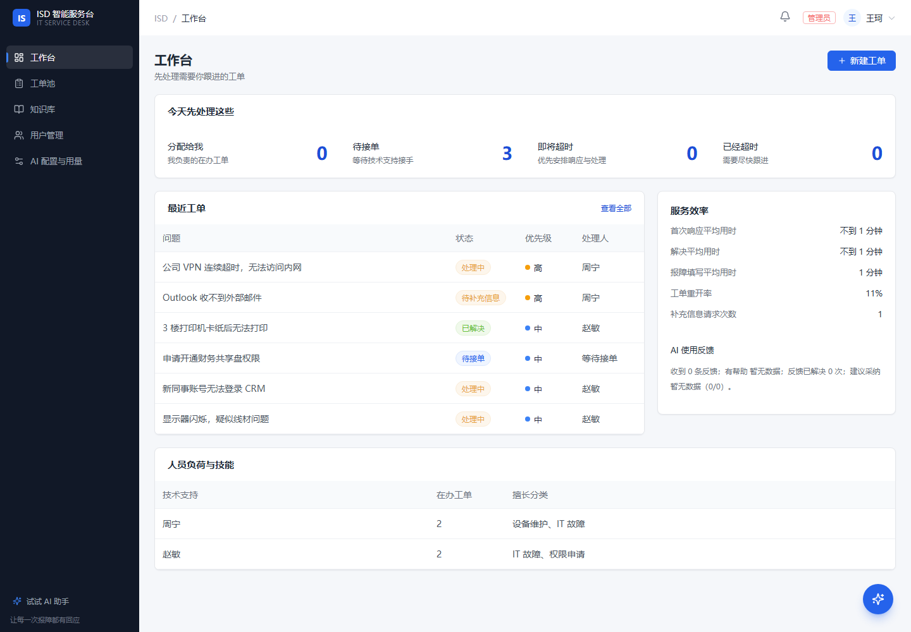

# ISD v1.1.0 发布说明

**发布日期**：2026-11-03
**完整变更**：[CHANGELOG](../CHANGELOG.md) · **升级步骤**：[升级到 v1.1.0](upgrade.md) · **发布门禁**：[release-checklist](release-checklist.md)

企业 IT 智能服务台 v1.1.0：在 v1.0.0 的工单与 AI 基础上，补齐协作、时限、知识审核、多供应商 AI 配置与用量治理，并提供可直接运行的 JAR 与源码包。



## 本版亮点

- **员工报障更省事**：一句话描述即可生成可编辑草稿，AI 追问缺失信息，确认后才建单。
- **协作与时限**：公开回复 / 内部备注分离、附件、转派、待补充暂停计时、重开与操作时间线。
- **知识可复核**：已解决工单生成独立草稿，补充适用环境、步骤、复核日期，人工发布。
- **AI 可治理**：DeepSeek / 通义千问 / OpenAI / 自定义兼容服务；Key 加密、版本化、测试后切换；调用量、Token、用户分布与分币种费用。
- **一键启动**：Windows 双击 `demo.cmd`；macOS / Linux 一条 compose 命令。无需安装 Java/Node/MySQL/Redis。
- **可交付**：JAR 内含构建后的前端；源码包包含截图与启动脚本；附件提供 SHA-256 校验。

## 发布附件

| 文件 | 内容 |
|---|---|
| `isd-1.1.0.jar` | 可直接运行的 Spring Boot JAR，已包含构建后的前端页面 |
| `isd-1.1.0-source.zip` | 从最终发布提交生成的完整源码，含 `demo.cmd` / `start.cmd` / `stop.cmd`、`docker-compose*.yml`、截图与文档 |
| `SHA256SUMS.txt` | 上述两个文件的 SHA-256 校验值 |

```bash
sha256sum -c SHA256SUMS.txt
```

> JAR 仍需外部 MySQL 8 与 Redis 7；只想快速体验请用源码包里的 `demo.cmd`。

## 验证结果

| 门禁 | 命令 / 位置 | 结果 |
|---|---|---|
| 后端 | `./mvnw verify` | **207 用例通过**，JaCoCo 行覆盖 **94.50%**（门禁 ≥ 90%）、分支 76.22% |
| 前端 | `npm run lint && npm test && npm run build` | lint 0 warning；**37 单测通过**；构建成功 |
| 依赖 | `npm audit --omit=dev --audit-level=high` | 生产依赖无 high/critical |
| 镜像 | `docker build -t isd:local .` | 三阶段构建成功，非 root 运行 |
| 浏览器 E2E | `npx playwright test`（prod 栈） | 10 条通过；主流程含建单→接单→解决→关闭；CSP 违规 0 |
| 性能 | k6 冒烟（5 VU / 20s，setup 预热） | 工单读路径与 AI 配额通过，阈值未放宽 |
| 安全 | `curl -k -D - https://localhost/api/ping` | CSP / HSTS / Secure Cookie / CSRF 缺失 403 |
| 数字一致 | CI `@Test` 守卫 | 207 用例 / 69 接口 / 13 迁移 / 24 表 |

**证据**：

- CI：[workflows/ci.yml](https://github.com/adfkj2/intelligent-service-desk/actions/workflows/ci.yml)
- 覆盖率：CI `backend` job 产物 `jacoco-report`（本地 `target/site/jacoco/index.html`）
- E2E：CI `e2e` job 产物 `playwright-report` / `test-results`
- 压测：[perf-report.md](perf-report.md)

## 从 v1.0.0 升级

1. **先备份**：数据库（含附件）+ AI 主密钥（`ISD_AI_MASTER_KEY` 或 `master.key`）。
2. 停旧应用，替换为 `isd-1.1.0.jar` 或 v1.1.0 镜像。
3. 启动时 Flyway 自动执行 **V7–V13** 迁移；确认 `flyway_schema_history` 最新为 13。
4. 按 [升级文档](upgrade.md#3-升级后验证) 验证登录、工单、知识、AI 配置与附件。
5. 回滚以升级前备份恢复为准，不手工删表降级。

**不要**只备份数据库而漏掉主密钥：后台保存的供应商 Key 用主密钥加密，丢失后无法解密。

## 已知限制

- 列表检索仍是 `LIKE '%kw%'`；RAG 用 FULLTEXT ngram，暂无语义召回。
- AI 限流为固定窗口，窗口边界可能瞬时放行接近两倍配额。
- 处理时限按连续自然小时，不含工作日/节假日日历。
- 附件存数据库（单文件 ≤ 5 MB，单工单 ≤ 20 个），备份体积随附件增长。
- CSP 只在生产 profile 启用，`style-src` 保留 `'unsafe-inline'`。
- OWASP dependency-check 未接入，Java 传递依赖的 CVE 依赖 Dependabot。

## 截图说明

README 与本文档中的截图来自真实运行页面，使用隔离演示环境、虚构账号和示例数据；AI 用量为明确标注的模拟台账，配置保留真实的“待测试”状态，不含真实密钥、内部地址或个人信息。复现脚本见 `web/e2e/demo/`。
